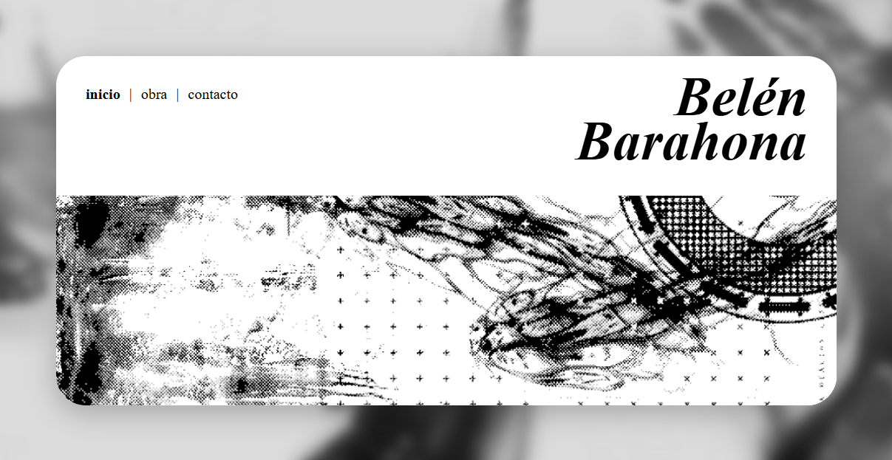
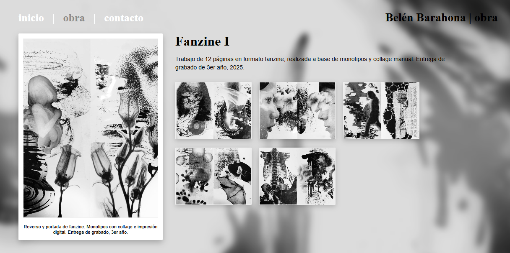
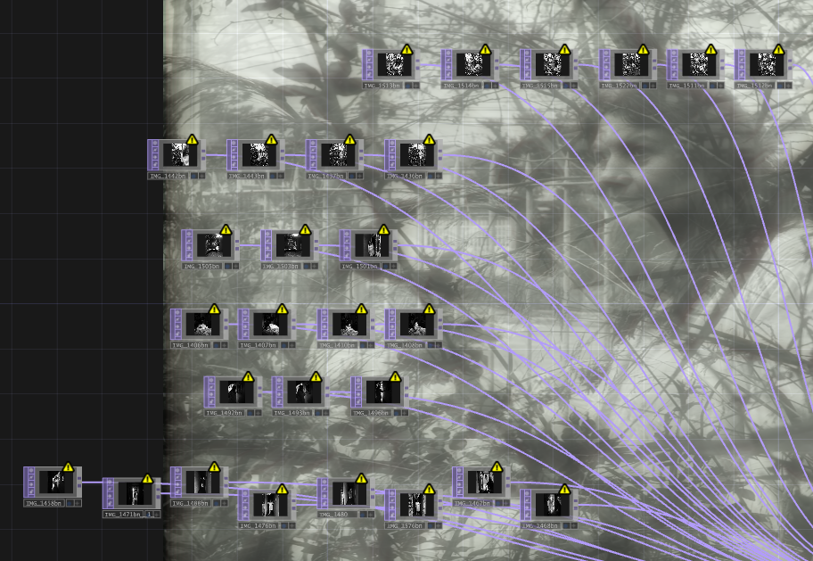
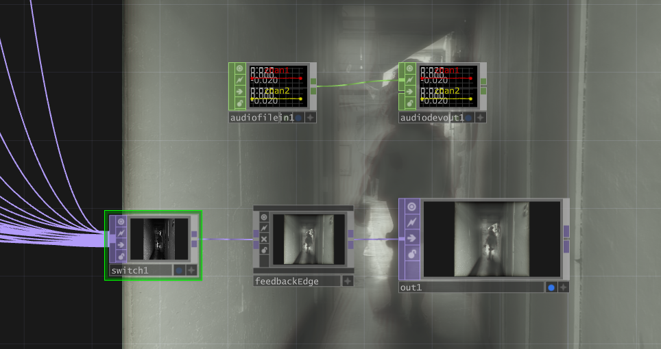

# multimedial
## Exploración creativa de arte, tecnología y medios digitales interactivos.

### index
## Unidad I.  Mi sitio web <br> 

5. [Mi sitio web portafolio](https://lenlody.github.io/barahona-portafolio/index.html)

```
<!DOCTYPE html>
<!-- Indica al navegador que este documento usa HTML5 -->

<html>
<!-- Inicio del documento HTML -->

<head>
<!-- Sección donde van metadatos, título y estilos -->

<meta charset="UTF-8">
<!-- Define la codificación de caracteres para que se vean bien tildes y símbolos -->

<title>Multimedial</title>
<!-- Título de la página que aparece en la pestaña del navegador -->

<style>
/* Aquí comienza la sección de estilos CSS que define la apariencia visual */

body{
/* "body" se refiere a todo el contenido visible de la página */

  background-color: white;
  /* Define que el fondo de toda la página sea blanco */

  color: black;
  /* Define que el color del texto sea negro */

  margin: 0;
  /* Elimina los márgenes que los navegadores agregan por defecto */

  height: 100vh;
  /* Hace que el alto del cuerpo sea igual al 100% de la altura de la pantalla */

  display: flex;
  /* Activa el sistema Flexbox para organizar y centrar elementos */

  justify-content: center;
  /* Centra el contenido horizontalmente */

  align-items: center;
  /* Centra el contenido verticalmente */

  font-family: Arial, sans-serif;
  /* Define la tipografía del texto */

  font-size: 60px;
  /* Define el tamaño grande del texto */

}
/* Fin de las reglas de estilo del body */

</style>
<!-- Fin de la sección de estilos -->

</head>
<!-- Fin de la sección head -->

<body>
<!-- Inicio del contenido visible de la página -->

MULTIMEDIAL
<!-- Texto que aparece en el centro de la pantalla -->

</body>
<!-- Fin del contenido visible -->

</html>
<!-- Fin del documento HTML -->
```
<span style="color: #99cef1">Mi página web</span><br>

Mi página web consiste en una presentación y obras realizadas por mí durante mi segundo, tercer y cuarto año de carrera en Artes Visuales. La realicé en primer semestre de cuarto año de la asignatura Taller Multimedial de Grado.

Me demoré un par de semanas en realizar las dos páginas que conforman mi web. Primero, realicé el inicio, el cual posee su página actual, la de mi obra y mi contacto, y al lado de estos, está mi nombre.




La imagen de fondo es una obra que hice durante segundo año, en 2024, que está difuminada. La imagen nítida bajo las secciones y mi nombre es un collage en Photoshop que realicé en cuarto año, en el primer semestre de 2026.

La sección de obras, la segunda, contiene diferentes trabajos hechos por mí durante la carrera. Me costó un poco encontrar imágenes y decidir cuáles poner, pero hubo 6 que me gustaron mucho.

(notas acerca de cómo las elegí: buena calidad de imagen, composición, colores nítidos y no tan llamativos, escaneados o fanzines)



- Fanzine I
Trabajo de 12 páginas en formato fanzine, realizada a base de monotipos y collage manual. Entrega de grabado de 3er año, 2025.
- Fanzine II: collage, transparencia, tiempo, hacer, hacer.
- Sin título 1: collage digital.
- Mujer, Mariposa, Fantasía | Estos tres trabajos los elegí también porque los tenía manualmente, conservo el collage y sus impresiones.


## Unidad II. [Programación visual creativa basada en nodos](#programación-visual-creativa-basada-en-nodos) <br>
1. [Intro ToucDesigner](#1-intro-a-touchdesigner) <br>
2. [Ejercicios:](#2-canasta-de-ejercicios) <br>

<span style="color:red">Ejercicio Lsystem</span><br>
link: https://drive.google.com/file/d/17kkeprhhJ95o54SF7PYyp5Yd8idTZJBE/view?usp=drive_link

- Ejercicio llamado Lsystem realizado en Touch Designer. Simula un árbol con tronco y ramas blancas con efecto bloom y tiene unas hojas circulares de color rojo.

<br>


##### Nube de puntos con Pop basada en imágenes, Lsystem, Mapping básico 


<span style="color:green">Ejercicio Noise/Point</span><br>
link: https://drive.google.com/file/d/1p3h60QSfKZ1pAhyaTHHiXqwQd4l2HRQ7/view?usp=drive_link

- Ejercicio con figuras interactivas que cambian según los sliders. En el centro tiene una figura con colores en formas circulasres que se mueven de dentro hacia afuera.

<br>


## <span style="color: #4e6f81">Mi trabajo final | Teresa</span><br>

Mi proyecto final del curso va de la mano con mi trabajo final de grabado. Consiste en 28 imágenes de mi tía que uní en secuencia en TouchDesigner con el efecto bloom.

Estas imágenes las tomé en su habitación, pasillo de su casa, patio y jardín mientras trae pijama. Mi intención es mostrar la intimidad y la depresión femenina mediante la fotografía para empatizar con las mujeres.



De unas 40 imágenes, para este trabajo decidí elegir 28 porque eran las que mejor combinaban entre sí, ya sea en composición o las posiciones de mi tía. Cada imagen va pasando de una en otra, mientras se ven borrosas.

En un inicio, la llamé por teléfono para preguntarle si podíamos hacer esta sesión de fotos, no estaba segura porque sé que es una instancia íntima y vergonzosa, pero yo estaba segura de lo que haría y que las fotos saldrían bien. Fui a su casa en septiembre, a finales del mes. Mientras le tomaba las fotos ella cambiaba de posición, a veces sola o se lo pedía, sin embargo, eso era lo único que yo intervenía, el resto de la habitación no la toqué.

Primero tomamos fotos en su habitación, luego vine otro día y le comé fotos en el pasillo, patio y jardín. También nos dio un poco de vergüenza tomarlas en el patio ya que pasaba gente.

Con el audio, se lo pedí por mensaje. Me lo mandó, aunque demoró un poco porque estábamos esperando a que se inspirara para grabar algo sincero y triste, y luego lo edité para cortar muletillas o silencios innecesarios.

En mi iglesia, una vez expuse sus fotografías. La gente estaba maravillada porque era algo que nunca habían visto, es un lugar poco común. Nadie la juzgó y la impresión del público fue positiva.



Conecté las imágenes con el switch y feedback edge, este último contiene el efecto blur para difuminar las imágenes. 

A la vez que pasan las imágenes, se escucha un audio de fondo de mi tía Teresa hablando sobre la depresión, el cual dura 2 minutos. En el programa lo conecté con un efecto leve de su voz.


